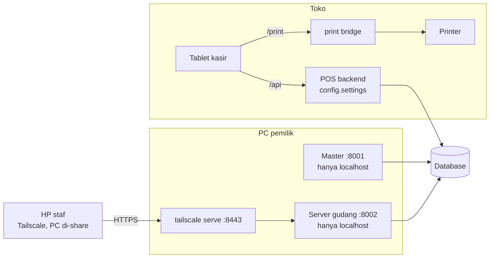

# Modul Master

Backoffice untuk POS Dunia Bangunan: data barang, harga, modal, stok per lokasi,
pembelian dan hutang supplier, transfer antar toko, nota manual, laporan, dan aplikasi
operasional untuk staf gudang di HP.

Modul ini **tidak mengubah satu pun berkas POS**. Semua kodenya ada di folder `master/`
dan dijalankan dengan pengaturan sendiri (`master.settings`) yang menumpang
`config/settings.py`. Kalau POS di-update, cukup tarik update-nya; master tetap jalan.

Isi:
[Gambaran besar](#gambaran-besar) ·
[Struktur folder](#struktur-folder) ·
[Akses dan hak](#akses-dan-hak) ·
[Hubungan dengan tabel POS](#hubungan-dengan-tabel-pos) ·
[Kasir: karyawan, PIN, tablet](#kasir-karyawan-pin-tablet) ·
[Stok per lokasi](#stok-per-lokasi) ·
[Aplikasi gudang](#aplikasi-gudang-gudang) ·
[Daftar fitur master](#daftar-fitur-master) ·
[Menjalankan](#menjalankan-untuk-pengembangan-tanpa-database-produksi) ·
[Server gudang](#server-gudang-untuk-hp-staf) ·
[Server rumah (Docker)](#server-rumah-docker) ·
[Cadangan](#cadangan) ·
[Batas](#batas-yang-perlu-diketahui)

## Gambaran besar

Ada tiga aplikasi yang memakai **database yang sama**, masing-masing untuk orang yang berbeda:

| Aplikasi | Untuk | Dijalankan | Alamat | Masuk dengan |
|---|---|---|---|---|
| Kasir (POS) | Kasir di toko | `pos-backend` (API) + `pos-frontend` | sesuai setup POS | PIN karyawan + perangkat terdaftar (milik POS, tidak disentuh master) |
| Master | Pemilik saja | `Start Master.bat` (`master.settings`) | `http://localhost:8001/` di PC pemilik | akun master (nama pengguna + kata sandi) |
| Aplikasi gudang | Kepala gudang, admin | `master\jalankan_gudang.bat` (`master.settings_gudang`) | lewat Tailscale ke PC yang sama | akun master yang punya hak gudang |



- **Kasir** tetap persis seperti buatan POS. Master hanya membaca dan menulis tabel POS
  yang perlu (lihat "Hubungan dengan tabel POS") dan menambah tabel `master_*` sendiri.
- **Master** sengaja hanya mendengar di `127.0.0.1`: tidak bisa dibuka dari perangkat lain.
- **Aplikasi gudang** adalah proses terpisah yang hanya memuat URL `/gudang/`. `/master/`
  dan `/api/` di proses itu 404, jadi HP staf tidak punya jalan ke master.
- Saat pengembangan, master memakai SQLite sendiri (`DATABASE_URL=sqlite:///db.sqlite3` di
  `master/.env`, diabaikan git), terpisah dari database kasir.

## Struktur folder

```
master/
├── settings.py, settings_gudang.py   pengaturan server master (:8001) dan server gudang (:8002)
├── wsgi_master.py, wsgi_gudang.py    titik masuk waitress
├── models.py                         semua tabel master_* (+ migrations/)
├── akun/        login, hak per akun, batas percobaan masuk (akses.py, masuk.py)
├── layanan/     aturan bisnis, tanpa HTTP: stok, lokasi, pembelian, transfer, opname,
│                laporan, Excel, ... (inti.py = fungsi bersama: log, ubah stok, Tolak)
├── views/       halaman web; hanya membaca formulir lalu memanggil layanan/
│                (utama.py = barang, harga, stok, pengguna; gudang.py = aplikasi gudang)
├── urls/        master.py (/master/), gudang.py (/gudang/), root.py dan root_gudang.py
├── templates/   master/ (halaman pemilik) dan gudang/ (aplikasi HP)
├── templatetags/, management/commands/   filter template dan perintah manage.py
└── tests/       uji per bagian: test_barang, test_stok, test_lokasi, test_pembelian, ...
```

Aturannya: logika (hitung stok, siapa boleh apa, catat log) ada di `layanan/` dan `akun/`;
`views/` tidak mengubah data sendiri. Jadi kalau nanti kasir perlu memanggil fungsi yang sama
(misalnya `layanan/ambil.py`), tinggal di-import tanpa menyalin kode.

## Akses dan hak

**Hak diatur per akun** di menu Pengguna (centang satu per satu), bukan per peran.
Urutan pemeriksaannya (`akses.hak_pengguna`):

1. Superuser Django: semua hak.
2. Akun dengan baris `master_hak_akun`: `semua=True` berarti semua hak, termasuk hak yang
   ditambahkan nanti; selain itu hanya hak yang dicentang.
3. Akun lama tanpa baris itu: hak dari peran (Group) `Super Admin`, `Finance`, atau `Gudang`.

Templat saat membuat akun: Pemilik (semua hak), Kepala gudang, Admin gudang, Kosong.

| Kelompok | Hak |
|---|---|
| Master (pemilik) | Membuka master · melihat/mengubah modal · harga jual dan floor · data barang · ganti nama · hapus barang (sampah) · rak · lokasi, pindah stok, tiket admin · import Excel · lihat/ubah stok, buka dus · opname (ACC) · pembelian, faktur, hutang · supplier · transfer · nota dan laporan · log · pengaturan · toko · pengguna dan hak |
| Aplikasi gudang | Membuka aplikasi gudang · catat barang datang · hitung stok (buta) · buka dus · konfirmasi barang diambil · lihat stok per lokasi (tanpa harga) · mengerjakan tiket pindah lokasi/rak |

| | Kepala gudang | Admin gudang | Pemilik |
|---|---|---|---|
| Catat barang datang, hitung stok, buka dus | ✓ | | ✓ |
| Konfirmasi barang diambil dari gudang | ✓ | | ✓ (dari master) |
| Lihat jumlah stok per lokasi | | ✓ | ✓ |
| Ajukan pindah lokasi/rak | | hanya di dalam tiket dari pemilik | ✓ langsung |
| ACC opname, tiket, selisih, PO | | | ✓ |

Pengaman lain:

- **Staf tidak pernah melihat harga beli, modal, harga jual, atau nama supplier.** Kepala
  gudang juga tidak melihat stok sistem (hitungan buta); admin hanya melihat jumlah per lokasi.
- Akun yang hanya punya hak gudang dan membuka `/master/` diarahkan ke `/gudang/`.
- Login master dan gudang: salah kata sandi 5 kali untuk satu nama pengguna, nama itu
  dikunci 15 menit (cache bersama milik POS).
- Cookie sesi master (`master_sessionid`) dan gudang (`gudang_sessionid`) terpisah dari
  satu sama lain dan dari POS.
- Akun tidak bisa mencabut hak "Membuka master" atau "Kelola pengguna" dari dirinya sendiri.
- Semua perubahan tercatat di log (`master_log`).

## Hubungan dengan tabel POS

| Tabel POS | Master membaca | Master menulis |
|---|---|---|
| `item` | barang, harga, stok | harga, data barang, modal terakhir, stok (PO, opname, transfer, nota manual, ubah stok), tambah/ganti nama/buang ke sampah |
| `transactions`, `transaction_detail` | nota dan laporan | hanya saat ganti nama barang (memindahkan baris nota ke nama baru) |
| `worker` | nama karyawan di laporan | tambah karyawan, ganti nama, PIN (menu Kasir) |
| `device` | daftar tablet (menu Kasir) | tidak |
| `worker_pin`, `device_status`, `pos_setting` | riwayat PIN, status tablet, aturan kasir | ya; tabel ini milik toko (migrasi `pos`), bukan tabel lama POS |

- **Stok total tetap satu angka di `item.in_stock`**, dan kasir memotongnya seperti biasa.
  Master hanya mencatat pembagiannya per lokasi.
- Kunci barang di POS adalah `(item_name, variant)`; master memberi ID tetap lewat
  `master_varian_info` (lihat "ID tetap").
- `transaction_detail` punya FK ke `item`, jadi barang yang sudah pernah terjual tidak
  bisa dihapus dari `item`. Karena kasir belum punya tanda "sembunyikan", barang seperti
  itu tidak bisa dibuang ke sampah.

## Kasir: karyawan, PIN, tablet

Menu **Kasir** (hak "Kasir: karyawan, PIN, tablet, aturan kasir"):

- **Karyawan & PIN**: tambah karyawan (PIN 6 angka dibuat sistem: tidak mudah ditebak dan tidak
  sama dengan PIN siapa pun yang masih mungkin dipakai), ganti nama, reset PIN, nonaktifkan.
  PIN terbaca (`master_pin_tampil`) hanya disimpan 3 hari setelah mulai berlaku untuk dibagikan
  (ada slip cetak); setelah itu hanya bisa di-reset. Kasir sendiri hanya menyimpan hash.
- **Riwayat PIN** (`worker_pin`): tiap PIN punya jendela berlaku. Kasir mencocokkan nota dengan
  PIN yang berlaku **saat nota dibuat** (`transaction_time`), jadi nota offline yang baru terkirim
  setelah PIN diganti tetap diterima selama `pin_tenggang_hari`. PIN lama yang di luar masa
  berlakunya tidak dihitung sebagai percobaan menebak PIN. Jam tablet yang maju lebih dari 10
  menit tidak bisa memakai PIN yang belum berlaku. Karyawan lama tanpa riwayat diberi baris
  "berlaku sejak awal" saat menu dibuka.
- **Ganti PIN berkala** (Aturan kasir): tiap N hari pada hari & jam tertentu. PIN baru dibuat
  `rotasi_siapkan_hari` sebelumnya oleh layanan `jadwal` (`manage.py master_jadwal --terus`),
  muncul di Karyawan & PIN untuk dibagikan, lalu berlaku tepat pada jamnya. Mengubah jadwal
  membatalkan PIN yang sudah disiapkan untuk jadwal lama.
- **Tablet kasir**: daftar tablet (kode, nama, terakhir terlihat), nonaktifkan/aktifkan, dan
  **pendaftaran tablet baru buka/tutup** (whitelist). Tertutup = pendaftaran baru ditolak 403;
  tablet nonaktif ditolak di semua API bertoken. `/api/items/` sekarang wajib token tablet;
  tablet memeriksa sambungan lewat `/api/health/` (tanpa data).

### Aturan jual (17 Okt 2026)

- **Stok boleh minus.** Server tidak lagi menolak penjualan karena stok 0 atau kurang, dan
  tablet tidak lagi mengunci barang berstok 0 (hanya ditandai). Stok minus terlihat di master.
- **Nota perlu ACC** (`nota_tinjau`, menu Kasir): tablet mengirim `final_lokal: true` untuk
  nota yang sudah final di tablet (PIN cocok lokal, sudah dicetak). Kalau nota seperti itu gagal
  diperiksa server (PIN tidak dikenal / di luar masa berlaku, harga di bawah floor sekarang,
  barang sudah dihapus, dsb.), server **menahannya** dan menjawab tablet `status: new` +
  `ditahan: true`, jadi tablet tidak macet. Pemilik memilih **Terima** (masuk penjualan pada
  waktu aslinya, stok dipotong, harga tidak dicek ulang; kasir dipilih kalau PIN tidak
  dikenali) atau **Tolak** (tetap tercatat, tidak dihitung). Nota yang belum final tetap
  ditolak seperti biasa, supaya kasir bisa memperbaikinya. Konflik nomor (409) dan batas
  percobaan PIN (429) tidak ditahan.
- **Harga di bawah floor** (keranjang tablet): boleh diketik, lalu di langkah PIN kasir wajib
  memilih salah satu: **PIN penyetuju** (karyawan yang ditandai "penyetuju" di Karyawan & PIN,
  pengaturan `penyetuju_floor`; diperiksa server, nota langsung masuk, persetujuan tercatat di
  `nota_persetujuan` dan tampil di panel nota master) atau **"tidak ada penyetuju"** (`minta_acc`:
  nota masuk Nota perlu ACC). Di atas pricelist dan harga pas (floor = pricelist) tetap ditolak.
  PIN penyetuju tidak dicocokkan di tablet; saat offline nota final disimpan dan diperiksa
  server waktu terkirim (salah = masuk Nota perlu ACC).
- **Batas uang kembali** (`refund_maks_persen`, Aturan kasir, bawaan 100): uang yang keluar
  lewat void + retur + refund pada satu nota paling banyak X% dari total nota.

### Hasil QA 18–19 Okt 2026 (yang berubah di kasir)

- **PIN penyetuju tidak dikirim ke tablet.** Tablet hanya menyimpan PIN kasir biasa (dibutuhkan untuk jualan
  offline). Persetujuan harga di bawah floor tetap bisa saat offline: PIN penyetuju dikunci dengan kunci publik
  server di tablet (`pos/kunci_pin.py`, kunci dibuat sekali di tabel `pos_setting`) dan dicek begitu nota terkirim.
  Akibatnya penyetuju tidak bisa menjadi kasir dengan PIN-nya sendiri saat tablet offline.
- **Diskon per barang ditolak server**; harga dinego langsung di harga barang.
- **Nota lebih dari 10 menit di depan jam server** ditolak, atau ditahan di Nota perlu ACC kalau sudah final di
  tablet. Tablet menampilkan peringatan kalau jamnya beda lebih dari 5 menit dari server.
- **Laporan dan dashboard memakai angka bersih**: refund, retur, dan void mengurangi penjualan pada tanggal
  kejadiannya; modal barang retur yang masuk stok menambah laba lagi, yang rusak tidak.
- **Tablet**: alias ikut di daftar barang dan pencarian offline per kata (nama + varian + alias); antrean nota
  terkirim sendiri tiap 30 detik saat server menjawab; service worker membuat kasir tetap terbuka saat dimuat ulang
  tanpa jaringan (butuh HTTPS `tailscale serve`, hanya build produksi).
- Dependensi baru `cryptography` (requirements.txt): jalankan `docker compose build` setelah `git pull`.

## Data barang yang dibaca kasir (17 Okt 2026)

- **Alias**: master sumber utama (`master_item_info.alias` + `alias_tambahan` per varian).
  Setiap perubahan alias (panel barang, Excel, ganti nama) menulis ulang baris `item_alias`
  barang itu (`layanan/alias_kasir.py`); alias varian dipetakan ke nama barangnya. Sekali di
  awal, `master_setup` menggabungkan alias lama di `item_alias` ke master (penanda
  `alias_tergabung` di `pos_setting`) supaya tidak ada yang hilang.
- **Barang nonaktif** (`master_varian_info.aktif = false`) tidak dikirim ke tablet, baik di daftar
  barang maupun pencarian. Barang yang sudah pernah terjual jadi bisa disembunyikan tanpa dihapus.
- **Rak**: kode rak varian dikirim di `/api/items/` (`rak`) dan tampil di daftar barang tablet.
- **Urutan alami**: daftar tanpa pencarian dan katalog offline tablet diurutkan seperti master
  ("2 MM" sebelum "10 MM"). Hasil pencarian tetap diurutkan menurut kemiripan.
- Kasir (`config.settings`) tidak memuat aplikasi master, jadi `pos/data_master.py` membaca
  `master_varian_info` lewat SQL dan hanya kalau tabelnya ada.
- **Penjualan kasir di Riwayat stok**: setiap pemotongan stok oleh nota kasir dicatat di
  `mutasi_kasir` (stok sebelum/sesudah persis, di transaksi yang sama). Riwayat stok master
  menggabungkannya dengan perubahan lewat master; filter "Penjualan kasir" tersedia.

## Stok per lokasi

- **Lokasi** tidak dibatasi jumlahnya. Tepat satu berjenis `toko` (rak/display), sisanya
  `gudang`. Rak menunjuk ke satu lokasi.
- Stok gudang disimpan di `master_stok_lokasi`. **Stok Toko dihitung**:
  total kasir − jumlah semua gudang + barang yang sedang menunggu diambil.
- Aturan: **stok gudang hanya boleh keluar lewat penjualan dan transfer.** Pengurangan lain
  (opname, retur supplier, buka dus, pindah) lewat alur yang tercatat dan butuh pemilik.
- **Permintaan ambil**: nota manual atau transfer yang barangnya "diambil dari" gudang tidak
  langsung mengurangi gudang. Sistem membuat permintaan; selama menunggu barangnya
  berstatus "dipesan". Kepala gudang menekan "Sudah diambil" dengan jumlah dan gudang
  sebenarnya; baru saat itu gudang berkurang. Jumlah beda wajib catatan dan masuk laporan
  selisih. Pemilik bisa mengonfirmasi dari master kalau kepala gudang tidak ada.
- **Tugas pindah barang** (dulu "tiket admin"): pemilik membuka tiket untuk satu akun admin (tujuan, batas waktu). Admin
  mengisi rencana pindah stok/rak di HP (per barang, per rak, per kategori), lalu mengirim.
  Pemilik ACC per baris dan boleh mengubah jumlah atau tujuan. Total stok tidak berubah.
- **Cek stok acak**: pemilik meminta sistem memilih barang acak di satu lokasi, menghitung
  tanpa melihat angka sistem, lalu menerapkan selisih per baris.
- **Selisih stok**: menggabungkan stok opname yang di-ACC, cek stok acak, dan barang diambil
  yang jumlahnya beda; dikelompokkan per lokasi, orang, kategori, dan barang.
- **Export/import Excel stok** (halaman Stok per gudang dan Stok barang): satu format
  untuk stok total dan jumlah tiap gudang. Ubah angka di Excel, unggah, lihat pratinjau, lalu
  Terapkan. Yang diterapkan adalah selisih dari angka saat export (disimpan di sheet tersembunyi
  `_asal`), jadi penjualan di antara export dan impor tidak terhapus. Ubah stok_total = stok kasir
  berubah (riwayat stok jenis "Import Excel"); ubah kolom gudang saja = pindah antara Toko dan gudang.
- Stok Toko yang minus berarti barang terjual dari rak tanpa pernah resmi diambil dari
  gudang; ditampilkan sebagai temuan, tidak ditolak.

## Aplikasi gudang (`/gudang/`)

Tampilan untuk layar HP. Menu muncul sesuai hak akun.

- **Barang datang**: memilih pesanan yang dibuat pemilik, mengisi jumlah yang datang dan
  lokasi penyimpanannya. Harga, PPN, dan ongkir diisi pemilik di master sebelum ACC.
- **Hitung stok**: pilih lokasi, cari barang atau pilih rak, isi jumlah fisik, ajukan. Stok
  sistem tidak diperlihatkan. Stok berubah setelah pemilik ACC, dan yang diterapkan adalah
  selisihnya supaya penjualan sesudah penghitungan tidak ikut terhapus.
- **Buka dus**: hanya untuk pasangan yang dibuat pemilik; pilih dus diambil dari mana dan
  isinya ditaruh di mana.
- **Ambil**: daftar permintaan ambil (dengan angka di menu), konfirmasi jumlah sebenarnya.
- **Stok per lokasi** (admin): jumlah per lokasi, tanpa harga.
- **Tiket** (admin): mengisi tiket pindah lokasi/rak dari pemilik.

Di PC bisa dibuka dari server master (`localhost:8001/gudang/`). Untuk HP staf pakai
server gudang (di bawah).

## Daftar fitur master

- Login dengan hak per akun (lihat "Akses dan hak").
- Daftar barang: satu baris per barang; cari (nama, varian, brand, alias), filter
  kategori, brand, rak, status, dan "perlu diperbaiki". Klik barang untuk membuka
  panel di kanan dan mengedit variannya.
- Di tabel yang bisa diedit: panah atas/bawah dan Enter pindah baris, Tab pindah
  kolom, Esc membatalkan. Klik dua kali nama barang atau varian untuk ganti nama.
- Harga & Modal: tabel harga per varian dengan margin, dan ubah massal (persen,
  rupiah, atau tetapkan; dengan pembulatan dan alasan) lewat pratinjau.
- Modal terakhir (item.cost_amount) dan modal rata (master_varian_info.modal_rata)
  dipisah. Sampai barang masuk dicatat, modal rata mengikuti modal terakhir.
- Inventory: stok dengan kolom "hitungan baru", riwayat stok, dan supplier.
- Pembelian: pesanan ke supplier, barang datang, ACC, faktur dengan pilihan PPN,
  hutang, dan pembayaran (boleh dicicil). Stok, modal, dan hutang berubah hanya saat ACC.
- Ongkir pembelian: diisi saat barang datang, dibagi ke tiap barang menurut nilainya dan
  ikut ke modal. Masuk hutang hanya kalau ditagih supplier di faktur yang sama.
- Retur ke supplier (setelah ACC): stok turun, hutang berkurang, modal rata dihitung
  mundur. Kalau faktur sudah dibayar, uang yang harus kembali dicatat terpisah.
- Catat faktur saja (dulu "Faktur di luar PO"): faktur supplier yang tidak lewat pesanan (pesanan mendadak, atau
  faktur lama). Isinya nomor faktur, supplier, tanggal, jatuh tempo, total, daftar barang
  (teks bebas), catatan, dan foto (boleh lebih dari satu, JPG/PNG/PDF). Bisa dicicil, atau
  langsung ditandai lunas untuk faktur lama. **Hanya mencatat hutang: stok dan modal tidak
  berubah dari sini.** Faktur yang nomornya sudah ada di PO supplier yang sama ditolak.
- Hutang supplier: semua faktur belum lunas (PO dan di luar PO) dalam satu daftar, urut jatuh tempo.
- Buka dus: pasangan konversi yang dikunci (kemasan besar -> eceran), isi tetap atau
  diisi saat dibuka; stok dan modal ikut pindah.
- Stok opname: menyetujui (per baris) atau menolak hitungan stok dari kepala gudang.
- Pengaturan: tarif PPN bertanggal.
- Toko: daftar toko, tidak dibatasi jumlahnya. Tiap toko punya kode, nama, atas nama
  (pemilik/NPWP), alamat, dan status PKP sendiri. Satu toko bertanda "stok di kasir":
  stoknya adalah stok di tabel kasir. Toko lain dicatat PO, faktur, hutang, opname, dan
  transfernya, tapi stoknya belum dihitung sistem sampai punya kasir sendiri.
- PO, faktur di luar PO, hutang, dan opname punya label toko. Pilihan toko hanya muncul
  kalau toko aktif lebih dari satu. PO untuk toko tanpa kasir hanya mencatat hutang.
- Transfer antar toko: disiapkan, dikirim (stok toko asal berkurang kalau toko itu
  memegang stok kasir; surat jalan bisa dicetak tanpa harga), diterima (jumlah yang
  sampai; beda wajib catatan; stok toko tujuan bertambah kalau memegang stok kasir).
  Nilainya (jumlah sampai x modal saat dikirim) masuk saldo antar toko; pelunasan dicatat
  di halaman Saldo antar toko. Batal setelah dikirim mengembalikan stok.
- Nota: daftar nota kasir dengan filter periode, karyawan, cara bayar, perangkat, dan
  pencarian; klik nota untuk melihat isi, modal, laba, dan bukti transfer. Hanya baca.
- Nota tulis tangan: penjualan dari nota tulisan tangan (toko tanpa kasir, atau pembeli yang
  lebih nyaman nota tangan). Barang dipilih dari daftar barang; harga diketik seperti di
  nota (di bawah floor ditandai, tidak ditolak); ongkir, pembeli, nomor nota kertas, foto.
  Toko yang memegang stok kasir: stok langsung berkurang. Tidak bisa diubah; kalau salah,
  dibatalkan (stok kembali) lalu diinput ulang. Ikut tampil di Nota, Laporan, dan
  penjualan hari ini di dashboard, dengan filter Toko dan Sumber (kasir/manual).
- Laporan: ringkasan per hari, per barang (bisa dirinci per varian), per kategori,
  per brand, per karyawan, per cara bayar; bisa di-export ke Excel. Urutan bawaan
  berdasarkan nilai penjualan, bukan jumlah biji.
- Kategori dan brand yang bisa diklik dan diganti namanya.
- Rak.
- Export dan import Excel. Import selalu lewat pratinjau.
- Log setiap perubahan.
- Dashboard "perlu diperbaiki".

- Keranjang sampah barang: barang dibuang (hilang dari kasir dan daftar), bisa dipulihkan;
  hapus permanen hanya untuk barang tanpa riwayat dan wajib kata sandi akun. Barang yang
  sudah tercatat di nota kasir tidak bisa dibuang (FK `transaction_detail` -> `item`).
- Lokasi stok, stok per gudang, tugas pindah barang, cek stok acak, pengambilan barang, selisih
  stok (lihat "Stok per lokasi").
- Export/import Excel stok: satu format untuk stok total dan stok per gudang (lihat "Stok per lokasi").
- Tampilan: tema oranye atau biru (seperti Moka) per akun; menu lipat yang bisa dikunci atau
  sembunyi otomatis, dan lebarnya bisa digeser.

## Menjalankan untuk pengembangan (tanpa database produksi)

Dari folder `POS/pos-backend`, dengan venv aktif:

```
pip install -r requirements.txt -r master/requirements.txt
```

Buat `.env` pengembangan (jangan pakai `.env` produksi):

```
DATABASE_URL=sqlite:///db.sqlite3
SECRET_KEY=isi-acak-yang-panjang-untuk-pengembangan-saja-0123456789
DEVICE_AUTH_SIGNING_KEY=isi-acak-lain-untuk-pengembangan
DEVICE_REGISTRATION_TOKEN=isi-acak-lain-lagi
```

Lalu:

```
python manage.py migrate --settings=master.settings
python manage.py master_devdb "C:\jalur\ke\DBengkulu_export.xlsx" --settings=master.settings
python manage.py master_setup --settings=master.settings
python manage.py createsuperuser --settings=master.settings
python manage.py runserver 8001 --settings=master.settings
```

Buka `http://localhost:8001/`. Setelah sekali disiapkan, cukup jalankan
`POS\Start Master.bat`. Bat itu menjalankan master dengan waitress
(`master.wsgi_master`), bukan `runserver`: `runserver` memeriksa perubahan berkas terus-menerus
(sekitar 1% CPU walau tidak dipakai) dan memakai dua proses. `runserver` cukup untuk mengembangkan.

`master_devdb` membuat tabel POS dan mengisinya dari berkas export. Perintah itu
menolak jalan kalau tabel `item` sudah berisi.

Uji otomatis:

```
python manage.py test master --settings=master.settings
python manage.py test master.tests.test_lokasi --settings=master.settings   (satu bagian saja)
```

## Server gudang untuk HP staf

Master tetap hanya dibuka di PC (`localhost:8001`). Untuk HP staf ada **server gudang
terpisah** (`master.settings_gudang`) yang hanya memuat `/gudang/` dan halaman masuknya
sendiri (`/gudang/masuk/`). `/master/` dan `/api/` di server itu selalu 404, jadi HP staf
tidak punya jalan ke master walaupun menebak alamatnya. Database dan akunnya sama.

- Masuk hanya untuk akun yang punya hak "Membuka aplikasi gudang".
- Salah kata sandi 5 kali untuk satu nama pengguna: nama itu dikunci 15 menit
  (berlaku juga untuk login master).
- Cookie sesinya terpisah dari master.

Menyiapkan (sekali):

1. `venv\Scripts\pip install -r master\requirements.txt` (menambah `waitress`).
2. Di `master/.env` tambahkan (ganti dengan nama PC dan tailnet sendiri):
   ```
   GUDANG_ALLOWED_HOSTS=localhost,127.0.0.1,nama-pc.nama-tailnet.ts.net
   GUDANG_CSRF_TRUSTED_ORIGINS=https://nama-pc.nama-tailnet.ts.net:8443
   GUDANG_HTTPS=1
   ```
3. Jalankan `master\jalankan_gudang.bat`. Server hanya mendengar di `127.0.0.1:8002`,
   jadi tidak terbuka ke WiFi rumah.
4. Buka ke tailnet (HTTPS, sertifikat dari Tailscale; MagicDNS dan HTTPS harus aktif di
   admin console): `tailscale serve --bg --https=8443 http://127.0.0.1:8002`
5. HP staf: pasang Tailscale dengan akun mereka sendiri, lalu PC ini di-*share* ke akun
   mereka (Share di admin console). Mereka hanya melihat PC ini, bukan perangkat lain.
6. Batasi port untuk akun yang di-share di access controls, contoh:
   ```
   "grants": [
     {"src": ["autogroup:member"], "dst": ["*"], "ip": ["*"]},
     {"src": ["autogroup:shared"], "dst": ["*"], "ip": ["tcp:8443"]}
   ]
   ```
   Gabungkan dengan aturan yang sudah ada; jangan ditimpa begitu saja.
7. Di HP buka `https://nama-pc.nama-tailnet.ts.net:8443/`.

PC harus menyala dan `jalankan_gudang.bat` berjalan selama staf memakai aplikasinya.

## Server rumah (Docker)

Master dan aplikasi gudang bisa dijalankan di server Linux rumah dengan Docker, memakai
PostgreSQL sendiri (bukan database kasir di cloud). Berkasnya di `master/server/`:

| Berkas | Isi |
|---|---|
| `compose.yaml` | tiga layanan: `db` (PostgreSQL 17), `master` (:8001), `gudang` (:8002) |
| `Dockerfile`, `Dockerfile.dockerignore` | image Python 3.12; `.env`, `venv`, SQLite, dan media tidak ikut image |
| `siapkan.sh` | membuat `.env` berisi rahasia acak dan folder data di HDD |

Letak data:

- Database PostgreSQL: volume Docker `master_pgdata` (di SSD, `/var/lib/docker`).
- Foto faktur dan nota: `/srv/data/master/media` (HDD). Cadangan zip: `/srv/data/master/cadangan`.
- `/srv/data/master/pindah`: tempat menaruh `db.sqlite3` dari PC lama, dibaca saja oleh kontainer.

Master dan gudang hanya mendengar di `127.0.0.1` server, sama seperti di PC Windows. Dari
laptop, buka lewat SSH tunnel: `ssh -L 8001:127.0.0.1:8001 akun@server-rumah`, lalu
`http://localhost:8001/`. Untuk HP staf, gudang dibuka dengan `tailscale serve` seperti di
"Server gudang untuk HP staf" (isi `GUDANG_*` di `master/server/.env`, bukan `master/.env`).

Pemasangan pertama (di server, dari `pos-backend/master/server`):

```
bash siapkan.sh
docker compose build
docker compose up -d db
docker compose run --rm master python manage.py migrate --settings=master.settings
```

Lalu salah satu:

- **Pindah dari master di PC Windows (SQLite).** Matikan master di PC dulu supaya tidak ada
  perubahan yang tertinggal, salin `pos-backend/db.sqlite3` ke `/srv/data/master/pindah/` dan
  isi folder `pos-backend/media/` ke `/srv/data/master/media/`, lalu:
  ```
  docker compose run --rm master python manage.py master_pindah_db /data/pindah/db.sqlite3 --yakin --settings=master.settings
  docker compose run --rm master python manage.py master_setup --settings=master.settings
  ```
  `master_pindah_db` memindahkan data master, akun, **dan** tabel kasir di SQLite itu (barang,
  harga, modal, stok, nota) dalam satu transaksi, lalu mencocokkan jumlah baris tiap tabel.
  Kalau ada yang tidak cocok, tidak ada yang disimpan. Kode di PC dan di server harus versi
  yang sama (versi migrasi master dicek). Ini beda dengan `master_pulihkan`, yang hanya
  memuat data master dan akun.
- **Mulai baru:** `master_setup`, lalu `createsuperuser` (keduanya dengan
  `--settings=master.settings`).

Terakhir: `docker compose up -d`. Kontainer menyala lagi sendiri setelah server restart.

Memperbarui kode: `git pull`, `docker compose build`, jalankan `migrate` seperti di atas kalau
ada migrasi baru, lalu `docker compose up -d`. Migrasi tidak pernah dijalankan otomatis.

### Kasir di server rumah (satu database)

Sejak 17 Okt 2026 kasir memakai database yang sama dengan master di server rumah. Neon
tidak lagi dipakai sebagai database kasir, hanya sebagai tempat cadangan terenkripsi.

| Layanan | Isi | Alamat di server |
|---|---|---|
| `kasir` | backend POS (`config.settings`, waitress, `POS_DEBUG=0`) | hanya di jaringan Docker |
| `web` | halaman kasir hasil build + Caddy: `/api` ke `kasir` (token registrasi perangkat disuntik di sini), `/print` ke laptop toko | `127.0.0.1:5173` |
| `cadangan` | cadangan harian lokal + Neon | tidak membuka port |

Isi di `master/server/.env` (`bash siapkan.sh` menambahkan isian yang belum ada tanpa mengubah
yang sudah diisi):

- `PRINT_BRIDGE_TARGET`: alamat dari aplikasi Penghubung Cetak di laptop toko
  (Pengaturan → "Untuk server POS"), mis. `http://100.x.y.z:9101`.
- `VITE_STORE_NAME`, `VITE_STORE_ADDRESS`, `VITE_STORE_PHONE`, `VITE_STORE_CODE`: identitas di
  nota. Dibaca saat build, jadi setelah diubah: `docker compose build web && docker compose up -d web`.

Pertama kali (setelah `git pull`):

```
bash siapkan.sh
docker compose build
docker compose run --rm master python manage.py migrate --settings=master.settings
docker compose run --rm master python manage.py master_setup --settings=master.settings
docker compose up -d
sudo tailscale serve --bg --https=443 http://127.0.0.1:5173
```

`master_setup` membuat tabel kasir (`item`, `transactions`, `worker`, `device`, `item_alias`, ...)
dan ekstensi `pg_trgm` kalau belum ada; aman dijalankan ulang. Tablet membuka
`https://<nama-server>.<tailnet>.ts.net/`. Lewat HTTPS halaman kasir dianggap aman oleh browser
(secure context), beda dengan `http://IP`.

### Cadangan ke Neon (terenkripsi)

Layanan `cadangan` (`master/server/cadangan/cadangan.py`) tiap hari jam `CADANGAN_JAM` (bawaan
02:30):

1. `pg_dump` seluruh database (kasir + master) ke `/srv/data/master/cadangan/db/` (HDD), 7 terakhir disimpan.
2. Mengenkripsi salinan itu dengan AES-256-GCM memakai `CADANGAN_KUNCI`, potong 4 MB, lalu
   mengunggahnya ke tabel `cadangan_berkas`/`cadangan_potong` di Neon. 14 terakhir disimpan.
3. Mengunduh ulang dari Neon, membukanya, dan mengecek dengan `pg_restore --list`. Baru setelah
   lolos cadangan itu ditandai berhasil.

Neon hanya melihat byte acak. **`CADANGAN_KUNCI` wajib disalin ke tempat aman di luar server**
(kertas/flashdisk): kalau server rusak dan kunci hilang, cadangan Neon tidak bisa dibuka siapa
pun. Isi `CADANGAN_NEON_URL` dengan koneksi database Neon khusus cadangan (sebaiknya project/
database baru, bukan database kasir lama), lalu `docker compose up -d cadangan`.

```
docker compose run --rm cadangan sekali     # buat cadangan sekarang
docker compose run --rm cadangan daftar     # daftar cadangan di Neon + ukuran database Neon
docker compose run --rm cadangan uji        # unduh yang terbaru, buka, cek bisa dipulihkan
docker compose logs cadangan                # hasil cadangan harian
```

Memulihkan (database rusak / pindah mesin; kunci yang sama wajib ada di `.env`):

```
docker compose run --rm cadangan unduh      # -> /srv/data/master/cadangan/db/pulih-<waktu>.dump
docker compose stop master gudang kasir web
docker compose exec -T db pg_restore -U master -d master --clean --if-exists --no-owner \
  < /srv/data/master/cadangan/db/pulih-<waktu>.dump
docker compose start master gudang kasir web
```

Kalau salinan lokal di HDD masih ada, pakai berkas `db-*.dump` itu langsung dengan perintah
`pg_restore` yang sama. Foto faktur dan bukti transfer (`/srv/data/master/media`) **tidak** ikut
cadangan database ini.

## Aplikasi operasional: perangkat, PIN, dan tiket data barang

Aplikasi operasional (`/gudang/`, dipakai admin dan kepala gudang) dijaga tiga lapis:

1. **Perangkat disetujui.** Browser/aplikasi yang pertama kali membuka `/gudang/` hanya melihat kode, mis. `OPS-7K3P`.
   Pemilik menyetujuinya di master, **Kasir › Perangkat operasional** (beri nama, setujui, atau cabut). Sebelum disetujui,
   halaman PIN pun tidak tampil. Mencabut perangkat langsung mengeluarkan siapa pun yang sedang masuk di situ.
   Cookie perangkat acak, ditandatangani, HttpOnly; database hanya menyimpan sidiknya. Data browser dihapus = perangkat baru.
2. **PIN kasir + hak per karyawan.** Karyawan masuk dengan PIN kasirnya sendiri. Haknya dicentang satu-satu di
   **Kasir › Karyawan & PIN**, kolom *Hak akses*:
   - Kasir: *Jualan di kasir* (dicabut = PIN tidak dikirim ke tablet dan ditolak untuk jualan/void/retur; nota offline
     lama yang telat terkirim masuk Nota perlu ACC) dan *Setujui harga di bawah floor*.
   - Gudang: ambil barang, barang datang, hitung stok, buka dus, lihat stok per lokasi.
   - Tugas lokasi: usul pindah stok, usul ganti/pindah rak. Tugas data barang: usul harga+floor, alias, aktif/nonaktif.
   Tombol Kepala gudang / Admin gudang / Admin barang hanya mengisi centang. Sistem membuat akun `ops-<id>` tanpa kata
   sandi. 10 PIN salah per perangkat = tunggu 5 menit. Karyawan dinonaktifkan atau semua hak gudang/tugasnya dicabut =
   langsung keluar. Sesi berakhir 10 jam setelah masuk. Masuk dengan nama pengguna + kata sandi (akun lama) masih ada di
   `/gudang/masuk/sandi/`. Menu dan halaman hanya terbuka sesuai hak; tiket data barang hanya bisa diberi izin yang
   dimiliki admin, dan kalau haknya dicabut belakangan, isian itu ikut hilang dari tiketnya.
3. **Tiket.** Admin tanpa peran kepala gudang tidak punya menu; setelah masuk hanya ada **Tugas**: tiket yang dibuka pemilik,
   apa yang boleh dikerjakan, dan sisa waktunya.

**Tiket data barang** (master: **Gudang › Tiket admin**, jenis *Data barang*): pemilik memilih admin, batas waktu, apa yang boleh
diusulkan (harga jual dan floor, alias, aktif/nonaktif), dan kategori/brand (kosong = semua). Admin hanya melihat nama barang,
varian, harga jual, floor, alias, dan status aktif, tanpa modal, stok, supplier, atau laba. Isiannya disimpan sebagai usulan
(`master_tiket_usulan`), floor di atas harga jual ditolak. Di halaman ACC semua usulan tercentang di awal, ada tombol
*Centang semua*, *Balik pilihan*, saringan *Hanya yang ditandai*, dan angka harga/floor boleh diubah dulu. Tanda: di bawah
modal (hanya akun yang boleh melihat modal), perubahan di atas X% (bawaan 20%), floor di atas harga jual, dan nilai yang sudah
berubah sejak diusulkan. *Terapkan yang dicentang* menerapkan lewat layanan biasa (tercatat di Log atas nama pemilik, catatan
`Tiket #n`, alias ikut terkirim ke kasir); sisanya ditolak dan tiket selesai.

Uji: `master/tests/test_ops.py`. Pengaturan `OPS_WAJIB_PERANGKAT` (bawaan `True`) hanya dimatikan di uji lama.

## Cadangan

Data master (supplier, PO, faktur, hutang, opname, log, akun, foto faktur) bisa
dicadangkan ke satu berkas zip. Tabel kasir tidak ikut; itu urusan sisi POS.

1. Isi folder tujuan di `master/.env`, sebaiknya folder yang tersalin ke luar PC
   (Google Drive, NAS):  `MASTER_CADANGAN_KE=G:\My Drive\Cadangan Master`
2. `Start Master.bat` membuat cadangan setiap kali master dinyalakan. Bisa juga manual:
   `python manage.py master_cadangan --settings=master.settings`
3. Yang disimpan 30 cadangan terakhir (`--simpan` untuk mengubah).

Memulihkan, ke database yang baru di-migrate (SQLite atau PostgreSQL):

```
python manage.py migrate --settings=master.settings
python manage.py master_pulihkan "path\master-cadangan-....zip" --yakin --settings=master.settings
python manage.py master_setup --settings=master.settings
```

Jalur yang sama dipakai kalau master pindah database (mis. dari SQLite di PC ke
PostgreSQL di server).

Sebelum mulai dipakai sungguhan, data percobaan bisa dikosongkan (cadangan dibuat
dulu otomatis). Data barang, akun, pengaturan, dan supplier tetap:

```
python manage.py master_kosongkan --yakin --settings=master.settings
python manage.py master_kosongkan --yakin --supplier --settings=master.settings   (supplier ikut dihapus)
```

## Tabel database

`migrate --settings=master.settings` hanya **menambah** tabel; struktur tabel POS tidak
diubah. Tabel master: `master_toko`, `master_lokasi`, `master_rak`, `master_item_info`,
`master_varian_info`, `master_log`, `master_impor`, `master_supplier`, `master_mutasi_stok`,
`master_pengaturan`, `master_tarif_ppn`, `master_pembelian`, `master_pembelian_baris`,
`master_pembayaran`, `master_faktur_manual`, `master_faktur_foto`, `master_faktur_bayar`,
`master_retur`, `master_retur_baris`, `master_opname`, `master_opname_baris`,
`master_transfer`, `master_transfer_baris`, `master_pelunasan_saldo`, `master_nota_manual`,
`master_nota_manual_baris`, `master_nota_manual_foto`, `master_konversi`, `master_buka_dus`,
`master_sampah`, `master_stok_lokasi`, `master_mutasi_lokasi`, `master_hak_akun`,
`master_hitung_acak`, `master_hitung_acak_baris`, `master_tiket`, `master_tiket_baris`,
`master_permintaan_ambil`, `master_preferensi_akun`, ditambah tabel bawaan Django untuk akun dan sesi.

## ID tetap

`master_varian_info.id` adalah ID tetap tiap varian. Nama boleh diganti, ID tidak
berubah. Kunci di tabel POS masih `(item_name, variant)`, jadi "ganti nama" di
master menyalin baris barang ke nama baru, memindahkan baris nota, lalu menghapus
baris lama, dalam satu transaksi.

## Titik sambung dengan kasir (belum dikerjakan)

Catatan supaya batasnya jelas, bukan daftar tugas. Hal-hal ini hanya bisa jalan kalau sisi
kasir ikut membaca atau menulis data master:

- Barang nonaktif, alias, dan rak belum dipakai kasir (kasir belum membaca `master_varian_info`).
- Penjualan di kasir belum membuat permintaan ambil gudang. Fungsinya sudah ada di master
  (`master/ambil.py`, `buat()`), tinggal dipanggil saat transaksi.
- Barang yang sudah terjual belum bisa disembunyikan dari kasir, jadi belum bisa dibuang ke sampah.

## Batas yang perlu diketahui

- **Status aktif/nonaktif belum dikenal kasir.** Barang nonaktif masih muncul di
  kasir sampai sisi POS membaca tabel `master_varian_info`.
- **Alias dan rak belum dipakai pencarian kasir**, dengan alasan yang sama.
- **Mengubah stok manual hanya lewat menu Stok**, untuk akun dengan hak "Mengubah stok".
  Penjualan kasir memotong stok langsung dan tidak masuk riwayat stok.
- **Ganti nama barang** membuat keranjang kasir yang sedang terbuka dengan nama
  lama ditolak saat dibayar.
- **Laba di Nota dan Laporan memakai modal rata saat nota dibuat**, disusun ulang dari
  log perubahan modal. Untuk nota sebelum modul master dipasang, yang dipakai adalah
  modal paling awal yang tercatat. Barang yang modalnya kosong ditandai `*` dan
  labanya tidak dihitung.
- **Ongkir tidak dipisah PPN-nya.** Angka ongkir diketik apa adanya dan seluruhnya masuk
  modal. Kalau toko sudah PKP dan ongkir di faktur kena PPN, ini perlu disesuaikan.
- **Retur tidak mengembalikan ongkir** dan tidak mengubah modal terakhir, hanya modal rata.
  Retur langsung berlaku, tidak ada langkah ACC, dan tidak bisa dibatalkan.
- **Foto faktur disimpan di folder `media/`** milik server yang menjalankan master (sudah
  diabaikan git). Kalau server pindah, folder itu ikut dipindah, atau fotonya hilang dari
  tampilan walau datanya tetap ada.
- **Nota kasir tidak bisa diedit atau dibatalkan dari master.** Retur dan pembatalan nota kasir belum ada.
- **Bukti transfer** hanya tampil kalau master berjalan di server yang menyimpan
  berkasnya.
- `MASTER_DEBUG=1` hanya untuk pengembangan. Untuk dipakai dari perangkat lain,
  isi `MASTER_ALLOWED_HOSTS` (dipisah koma).
